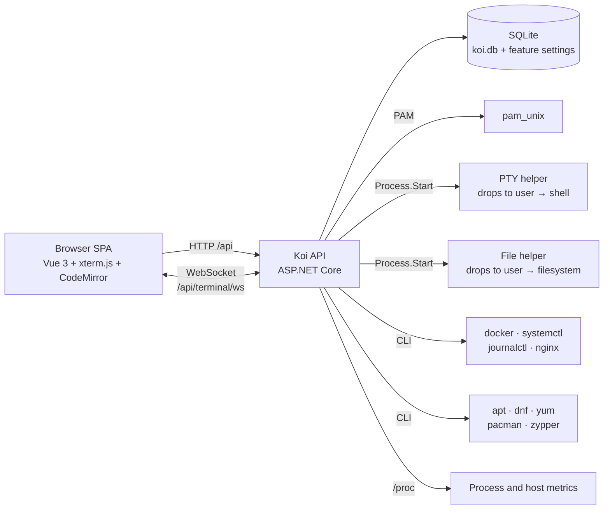

<p align="center">
  
</p>

<h1 id="koi" align="center">Koi</h1>

<p align="center">
  <strong>Koi Linux Web UI</strong> — administer a Linux host from your browser.
</p>

<p align="center">
  <a href="LICENSE"></a>
  
  
  
</p>

<p align="center">
  <strong>English</strong> · <a href="README.zh-CN.md">简体中文</a>
</p>

## Overview

Koi turns a Linux host into a workstation you can drive from a browser. Users sign in with their
**existing system account** — credentials are verified through PAM, so there is no separate user
database to maintain — and land in a single workspace with nine modules:

- a **home dashboard** with live CPU, memory, disk and network metrics;
- **online terminals**, a **file manager** and a **multi-file text editor**;
- **systemd service**, **process**, **application**, **container** and **Nginx configuration**
  management.

It targets homelabs, internal networks and self-hosted servers. It is remote-administration
software: a logged-in session is equivalent to a shell on the host as that user.

> **Status:** pre-1.0 and under active development. The UI is currently Chinese-only, and there is
> no automated test suite yet. See [Security](#security) before exposing it beyond a trusted
> network.

## Features

- **System account authentication** — passwords are verified by `pam_unix`; no local password
  store, no duplicate accounts.
- **Single-page workspace** — Home, terminal, files, editor, services, processes, applications,
  containers and Nginx tabs keep their state while hidden; closing a tab releases the resources
  behind it.
- **Multiple online terminals** — each tab owns an independent PTY and shell session; tabs stay
  alive while you switch around the workspace and are torn down when closed. Directories can be
  opened in a new terminal tab from the file manager, with the shell starting in that directory.
- **File management** — the file manager is itself tabbed, each tab browsing an independent
  directory. A resizable **quick-access** sidebar (per account, stored in SQLite) sits above a
  lazily loaded **directory tree**; the path bar can jump to absolute, `~`-relative or relative
  paths. Uploads, downloads, rename, copy/cut and paste with a clipboard shared across tabs.
- **Online text editing** — multiple files open at once in a CodeMirror-based editor, UTF-8 with
  optional BOM preserved, syntax highlighting chosen per file extension, and optimistic
  concurrency on save: if the file changed on disk, the editor offers overwrite or reload.
- **Service management** — list, inspect and control systemd services (`start` / `stop` /
  `restart` / `reload`), manage boot enablement, and read `journalctl` logs.
- **Process management** — inspect `/proc`-backed CPU/memory usage and command lines, view process
  details (executable, working directory, I/O, open descriptors) and terminate processes with
  `SIGTERM` or `SIGKILL`.
- **Application management** — install, remove and upgrade packages through apt, dnf, yum, pacman
  or zypper; a SQLite-cached installed-application list with paging and status filters; background
  jobs with live logs; add/enable/disable/remove software sources.
- **Container management** — list and inspect containers and images, start/stop/restart/pause,
  read logs and stats, pull/tag/prune/remove images through the docker CLI.
- **Nginx management** — list and edit `conf.d/*.conf`, run `nginx -t` for syntax detection and
  `nginx -s reload` for a hot reload.
- **Module settings in the UI** — each module's runtime configuration lives in SQLite and is
  edited by root through a settings drawer on its page; saved values apply immediately.
- **Health endpoint and ProblemDetails errors** for monitoring and client integration.

## Modules and authorization

| Workspace tab | Main capability | Who can use it |
| --- | --- | --- |
| Home | Host status dashboard and module launcher | Any signed-in account |
| Online terminal | PTY-backed shells running as the signed-in account | Any signed-in account |
| File manager | Directory browsing and file operations as the signed-in account | Any signed-in account (bounded by OS permissions) |
| Text editor | UTF-8 text editing, including Nginx config files | Any signed-in account; Nginx config tabs follow Nginx authorization |
| Service manager | `systemctl` / `journalctl` | root or a member of the configured groups (default `sudo`, `wheel`) |
| Process manager | `/proc` inspection and signals | root or `sudo` / `wheel` |
| Application manager | Package manager CLI | root or `sudo` / `wheel`; changes also require the Koi service itself to run as root |
| Container manager | docker CLI | root or the `docker` group |
| Nginx manager | conf.d files and nginx commands | root or `sudo` / `wheel` |
| Settings drawers | Per-module runtime configuration | root only |

Groups are resolved with `id -nG`, so NSS/LDAP groups count. uid 0 is always allowed once the
module itself is enabled and available. The configured group lists only constrain ordinary
accounts.

## Architecture



The ASP.NET Core process authenticates against PAM and hosts the built SPA. Because `pam_unix`
requires privileged access to the account database, the service itself must be privileged — so it
never touches user files or spawns shells directly. Terminal and file operations are executed by
helper processes (the same binary re-launched with a hidden argument) that drop to the
authenticated user (`initgroups` → `setgid` → `setuid`) before doing any work. The main process
communicates with them over pipes, never by `fork()`-ing managed code.

The privileged modules run their CLIs from the main process through `Process.Start` with an
argument list — never a shell — and only a fixed whitelist of subcommands. Docker, systemctl,
nginx and the package managers therefore act with the service account's privileges, which is why
they are restricted to configured groups. Processes and host metrics are read directly from
`/proc` without running external commands.

Sessions are server-side records in SQLite; the browser holds only an HttpOnly `koi_session`
cookie whose SHA-256 hash is stored. Terminal sessions live in memory and are destroyed when the
connection closes, when the user logs out, or on shutdown.

## Requirements

- **Linux** — terminal and file features depend on POSIX PTYs; on other platforms their endpoints
  return `503`. The privileged modules also need their respective tools (`docker`, `systemctl` /
  `journalctl`, `nginx`, a supported package manager).
- A working PAM service that can authenticate system accounts (`login` by default).
- **To build:** .NET SDK 10, Node.js 22+, npm. The publish command below produces a self-contained
  binary, so the target host needs no .NET runtime.
- **To run:** root or an equivalent privilege model, since `pam_unix` reads the account database.
  User-facing work is still performed as the authenticated user.
- **Optional groups:** add the administrator accounts to the groups configured for services,
  processes, applications and Nginx (default `sudo` / `wheel`) and the docker group for container
  management.

## Quick start (development)

```bash
git clone https://github.com/delly-net/Koi.git
cd Koi

# Terminal 1 — backend
cd api
dotnet run                 # http://localhost:5000

# Terminal 2 — frontend
cd ui
npm install
npm run dev                # http://localhost:5173
```

For the Vite dev server, set `"baseUrl": ""` in [ui/public/conf/setting.json](ui/public/conf/setting.json)
so API and WebSocket requests stay same-origin and are proxied to the backend (the session cookie
then works as-is). Authentication, terminal and file endpoints require Linux; use a Linux host or
VM for end-to-end testing.

## Build

```bash
# Backend: self-contained single-file binary
cd api
dotnet publish Koi.Api.csproj -c Release -r linux-x64 \
  --self-contained -p:PublishSingleFile=true -o ../publish

# Frontend
cd ../ui
npm ci
npm run build              # type-checks with vue-tsc, then builds to ui/dist

# The SPA must sit in wwwroot next to the executable
mkdir -p ../publish/wwwroot
cp -r dist/* ../publish/wwwroot/
```

Production builds replace `wwwroot/conf/setting.json` with
[deploy/linux/conf/setting.json](deploy/linux/conf/setting.json) (same-origin `baseUrl`); keep both
copies in sync.

## Deploy

The repository ships scripts under [deploy/linux/](deploy/linux/) (with a parallel set under
[deploy/debian/](deploy/debian/)). They assume the maintainer's layout (sources under
`/project/delly-net/Koi`) and can be adapted for your own paths.

```bash
# Register the service (files already copied to /opt/delly-net/Koi)
sudo deploy/linux/install.sh            # optional argument: service name, default "koi"

# Or build deb/rpm packages
./deploy/linux/package.sh all -p publish -o packages
sudo dpkg -i packages/koi-*.deb         # Debian / Ubuntu
sudo rpm -i  packages/koi-*.rpm          # RHEL / Fedora
```

`install.sh` and the packages install to `/opt/delly-net/Koi`, create the `koi.service` systemd
unit, enable and start it, and pre-seed `/etc/koi/appsettings.json` without overwriting an existing
file (packages keep it as a conffile / `%config(noreplace)`). Neither upgrades nor uninstalls touch
`koi.db`, so session data and configuration survive.

Logs: `journalctl -u koi -f`.

## Configuration

### Backend base settings

On Linux the backend overlays `/etc/koi/appsettings.json` on the bundled defaults. If the file is
missing it is created from the bundled copy on first start, and existing values are never
overwritten by upgrades. Keys omitted from it fall back to the bundled defaults, so keep
`appsettings.json` next to the binary. Command-line arguments and environment variables still take
precedence. Options are read once at startup, so changes require a restart.

| Key | Default | Description |
| --- | --- | --- |
| `Koi:Database:Path` | `koi.db` | SQLite file, relative to the content root |
| `Koi:StaticFiles:Enabled` | `true` | Serve the SPA from `wwwroot` |
| `Koi:StaticFiles:RootPath` | `wwwroot` | Static file root |
| `Koi:Auth:PamService` | `login` | PAM service used for authentication |
| `Koi:Auth:SessionExpireHours` | `8` | Session lifetime in hours |
| `Koi:Auth:CookieName` | `koi_session` | Session cookie name |
| `Koi:Auth:LoginRateLimitPerMinute` | `10` | Login attempts per IP per minute |
| `Koi:Auth:AllowedOrigins` | `[]` | Extra origins allowed for unsafe requests |
| `Koi:SystemMonitor:Enabled` | `true` | Enable the home dashboard status collector |
| `Urls` | `http://0.0.0.0:5000` | Kestrel listen address |

### Module settings (SQLite and settings drawers)

Terminal, file, editor, service, process, application, container and Nginx settings are **not**
read from `appsettings.json`. They live in SQLite and are edited by root through a gear button on
the top-right of each module page; saving applies immediately without restarting the service. The
legacy `Koi:Terminal`, `Koi:Files`, `Koi:Docker`, `Koi:Services`, `Koi:Packages`, `Koi:Nginx` and
`Koi:Processes` sections are no longer read.

| Module | Settings edited in the drawer | Storage |
| --- | --- | --- |
| Online terminal | Enable switch, shell and arguments, session caps, input cap, default size, close timeout | `FeatureConfigs` (`Feature = terminal`) |
| File manager | Enable switch, allowed roots, upload/list/text limits, helper and transfer timeouts | `FeatureConfigs` (`Feature = files`) |
| Text editor | Text-file extensions and the syntax scheme used for each one | `EditorFileTypes` table |
| Service manager | Enable switch, `systemctl` / `journalctl` paths, allowed groups, timeouts, output/log caps, log tail | `FeatureConfigs` (`Feature = services`) |
| Process manager | Enable switch, allowed groups, process and command-line caps, sampling, terminate wait, refresh interval | `FeatureConfigs` (`Feature = process`) |
| Application manager | Enable switch, package manager, allowed groups, timeouts, output/log caps, job retention and limits | `FeatureConfigs` (`Feature = packages`) |
| Container manager | Enable switch, docker path, allowed groups, timeouts, output/log caps, log tail | `FeatureConfigs` (`Feature = docker`) |
| Nginx manager | Enable switch, executable and config paths, conf.d directory, allowed groups, timeouts, size caps | `FeatureConfigs` (`Feature = nginx`) |

Quick-access directories (`FileQuickAccess`) and the installed-application cache
(`PackageCacheItems`) are also stored in SQLite. Settings endpoints are root-only and deliberately
skip the enabled/platform checks so a broken configuration can be repaired.

### Frontend

The frontend reads `conf/setting.json` at startup:

| Key | Description |
| --- | --- |
| `baseUrl` | Backend root **without** `/api`; `""` means same origin |

`conf/setting.json` is served `no-store`, so it can be edited after deployment without rebuilding.
The former `fileAssociations.text` field is deprecated and ignored: text associations and
highlighting schemes now come from the backend.

## API

All endpoints are under `/api`; errors use ProblemDetails. The session cookie is required except
for login and health. The full contract and the architecture constraints behind it are documented
in [CLAUDE.md](CLAUDE.md).

### Health and authentication

| Method | Path | Purpose |
| --- | --- | --- |
| `GET` | `/api/health` | Liveness plus platform capability flags |
| `POST` | `/api/auth/login` | Sign in with system credentials |
| `POST` | `/api/auth/logout` | End the session and close that user's terminals |
| `GET` | `/api/auth/me` | Current user |

### Terminal

| Method | Path | Purpose |
| --- | --- | --- |
| `GET` | `/api/terminal/ws[?cwd=]` | WebSocket terminal (JSON text frames) |
| `GET` / `PUT` | `/api/terminal/settings` | Terminal settings (root) |

### File manager

| Method | Path | Purpose |
| --- | --- | --- |
| `GET` | `/api/files/roots` | Allowed roots |
| `GET` / `PUT` | `/api/files/settings` | File settings (root) |
| `GET` | `/api/files/list?path=` | Directory listing |
| `POST` | `/api/files/mkdir`, `/touch`, `/rename`, `/delete`, `/copy`, `/move` | File operations |
| `POST` | `/api/files/upload?path=&overwrite=` | Multipart upload |
| `GET` | `/api/files/download?path=` | Download a file |
| `GET` / `POST` | `/api/files/text` | Read / write UTF-8 text |
| `GET` / `POST` | `/api/files/quick-access` | Per-account quick-access list / add |
| `DELETE` | `/api/files/quick-access/{id}` | Remove a quick-access entry |

### Text editor

| Method | Path | Purpose |
| --- | --- | --- |
| `GET` | `/api/editor/associations` | Text-file rules (readable by every signed-in account) |
| `GET` / `PUT` | `/api/editor/settings` | Extensions and syntax schemes (root) |

### Services

| Method | Path | Purpose |
| --- | --- | --- |
| `GET` / `PUT` | `/api/services/settings` | Service settings (root) |
| `GET` | `/api/services` | Service list with runtime and boot state |
| `GET` | `/api/services/{name}` | Service detail |
| `POST` | `/api/services/{name}/{start\|stop\|restart\|reload\|enable\|disable}` | Lifecycle action |
| `GET` | `/api/services/{name}/logs?tail=` | `journalctl` snapshot |

### Processes

| Method | Path | Purpose |
| --- | --- | --- |
| `GET` / `PUT` | `/api/processes/settings` | Process settings (root) |
| `GET` | `/api/processes` | Process snapshot with CPU and memory usage |
| `GET` | `/api/processes/{pid}` | Process detail |
| `POST` | `/api/processes/{pid}/terminate?force=` | SIGTERM, or SIGKILL with `force=true` |

### Applications

| Method | Path | Purpose |
| --- | --- | --- |
| `GET` | `/api/packages/status` | Detected manager, version and modification capability |
| `GET` | `/api/packages/installed`, `/search?q=`, `/updates` | Live package queries |
| `GET` | `/api/packages/cache?page=&pageSize=&status=&query=` | Cached installed-application list |
| `PUT` | `/api/packages/cache/{id}` | Edit a cached intro |
| `POST` | `/api/packages/cache/refresh` | Rebuild the cache |
| `POST` | `/api/packages/jobs` | Start an install/remove/upgrade/refresh job |
| `GET` | `/api/packages/jobs/{id}?offset=` | Incremental job log |
| `POST` | `/api/packages/jobs/{id}/cancel` | Cancel the running job |
| `GET` / `PUT` | `/api/packages/settings` | Application settings (root) |
| `GET` / `POST` | `/api/packages/sources` | List / add software sources |
| `POST` | `/api/packages/sources/{id}/enable`, `/disable` | Toggle a source |
| `DELETE` | `/api/packages/sources/{id}` | Remove a source |

### Containers

| Method | Path | Purpose |
| --- | --- | --- |
| `GET` / `PUT` | `/api/docker/settings` | Container settings (root) |
| `GET` | `/api/docker/status` | Docker version and daemon status |
| `GET` | `/api/docker/containers`, `/containers/{id}` | List / inspect containers |
| `POST` | `/api/docker/containers/{id}/{start\|stop\|restart\|pause\|unpause}` | Container action |
| `DELETE` | `/api/docker/containers/{id}?force=&volumes=` | Remove a container |
| `GET` | `/api/docker/containers/{id}/logs?tail=` | Container logs |
| `GET` | `/api/docker/stats` | One-shot resource usage |
| `GET` | `/api/docker/images` | Image list with container references |
| `POST` | `/api/docker/images/pull`, `/tag`, `/prune` | Image operations |
| `DELETE` | `/api/docker/images/{id}?force=` | Remove an image |

### Nginx

| Method | Path | Purpose |
| --- | --- | --- |
| `GET` / `PUT` | `/api/nginx/settings` | Nginx settings (root) |
| `GET` | `/api/nginx/status` | Version and conf.d directory |
| `GET` | `/api/nginx/configs`, `/configs/{name}` | List / read configuration files |
| `PUT` | `/api/nginx/configs/{name}` | Save a configuration file |
| `POST` | `/api/nginx/test`, `/reload` | `nginx -t` / `nginx -s reload` |

### Host status

| Method | Path | Purpose |
| --- | --- | --- |
| `GET` | `/api/system/status` | CPU, memory, swap, load, disks and network rates |

The terminal protocol is camelCase JSON: the client sends `input`, `resize` and `ping`; the server
sends `ready`, `output`, `exit`, `error` and `pong`. `/api/health` reports `pamAvailable`,
`terminalAvailable`, `fileAvailable`, `dockerAvailable`, `systemMonitorAvailable`,
`serviceAvailable`, `processAvailable`, `nginxAvailable` and `packageAvailable`.

## Security

Koi is administration software, not a hardened internet-facing bastion. Before deploying:

- **Terminate TLS in front of it.** There is no built-in HTTPS; the default listener is
  `http://0.0.0.0:5000`. Put Nginx, Caddy or similar in front, and do not expose the port directly
  to the internet. `X-Forwarded-For` / `X-Forwarded-Proto` are honored.
- **The service is privileged.** `pam_unix` needs access to the account database, and the bundled
  unit runs as root. Every shell and file operation is delegated to a helper that drops to the
  authenticated user, but you should still run Koi on a trusted host and restrict who can reach it.
- **Privileged modules are equivalent to host root.** The docker socket, `systemctl`, nginx
  configuration and package managers can change the whole system. Koi restricts them to the
  configured groups (and only root can edit their settings), but any allowed account is
  effectively an administrator. Grant those groups deliberately.
- **Authentication is PAM only.** No local password store, no multi-factor authentication, no
  auditing beyond the system's own logs.
- **Sessions:** HttpOnly `SameSite=Lax` cookie, only the SHA-256 hash stored server-side, 8-hour
  expiry, logout closes the user's terminals, and terminal state is dropped on disconnect.
- **Request hardening:** unsafe HTTP methods are same-origin checked, WebSocket handshakes are
  origin checked explicitly, and login attempts are rate-limited per IP.
- **Settings are root-only.** Module settings endpoints require uid 0 and a session; non-root users
  never see the settings drawers.
- **File visibility defaults to `/`.** Narrow the file manager's allowed roots (from its settings
  drawer) to what users actually need; the effective boundary is the operating system's
  permissions for the logged-in user. Quick-access entries are navigation shortcuts only — they do
  not grant access.
- Review `/etc/koi/appsettings.json` after deployment — base options are read once at startup, so
  changes require a restart. Module settings in SQLite apply immediately.

## Project layout

```
Koi/
├── api/                 ASP.NET Core minimal API (.NET 10)
│   ├── Auth/            PAM authentication, sessions, same-origin checks
│   ├── Configuration/   /etc/koi overlay and settings stores
│   ├── Data/            EF Core + SQLite entities and schema helpers
│   ├── Docker/          docker CLI runner, authorization and endpoints
│   ├── Editor/          Text-file rules, syntax schemes and endpoints
│   ├── Files/           File API, path policy, privilege-dropping helper
│   ├── Hosting/         Static files and SPA fallback
│   ├── Monitor/         /proc and statvfs host metrics
│   ├── Nginx/           conf.d files, nginx commands and endpoints
│   ├── Packages/        Package manager backends, jobs, sources and endpoints
│   ├── Processes/       /proc process sampling and signals
│   ├── Services/        systemctl / journalctl runner and endpoints
│   ├── Terminal/        PTY, helper process, session registry, WebSocket
│   └── Program.cs
├── ui/                  Vue 3 + TypeScript + Element Plus SPA (Vite)
│   ├── src/api/         HTTP wrapper and module/protocol types
│   ├── src/components/  Terminal, editor, file and system components
│   ├── src/config/      Runtime configuration and syntax schemes
│   ├── src/stores/      Pinia stores (auth, workspace, editor, clipboard, …)
│   ├── src/utils/       Layout and remembered-login helpers
│   ├── src/views/       Login page and workspace panels
│   └── public/conf/     Runtime configuration
├── deploy/
│   ├── linux/           Build, install and packaging scripts
│   └── debian/          Alternate build and packaging scripts
└── icon/                Application icons
```

## Contributing

Issues and pull requests are welcome. Please open an issue before starting a large change.

- Before submitting, run `dotnet build` in `api/` and `npm run build` in `ui/` (it also type-checks
  with `vue-tsc`).
- Terminal- and file-related changes must be verified on a Linux host; describe the manual checks
  in the pull request, since there is no automated test suite yet.
- New endpoints, protocol changes and architecture decisions should be documented in
  [CLAUDE.md](CLAUDE.md), which holds the architecture constraints and the current API contract.
- UI copy is Chinese; keep new strings consistent with the existing wording.

## License

[MIT](LICENSE) © 2026 delly.net
