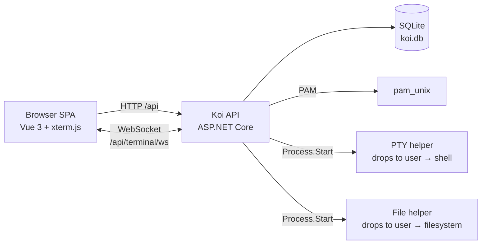

<p align="center">
  
</p>

<h1 id="koi" align="center">Koi</h1>

<p align="center">
  <strong>Koi Linux Web UI</strong> — administer a Linux host from your browser.
</p>

<p align="center">
  <a href="LICENSE"></a>
  
  
  
</p>

<p align="center">
  <strong>English</strong> · <a href="README.zh-CN.md">简体中文</a>
</p>

## Overview

Koi turns a Linux host into a workstation you can drive from a browser. Users sign in with their
**existing system account** — credentials are verified through PAM, so there is no separate user
database to maintain — and get a single workspace with online terminals, a tabbed file manager and
a multi-file text editor.

It targets homelabs, internal networks and self-hosted servers. It is remote-administration
software: a logged-in session is equivalent to a shell on the host as that user.

> **Status:** pre-1.0 and under active development. The UI is currently Chinese-only, and there is
> no automated test suite yet. See [Security](#security) before exposing it beyond a trusted
> network.

## Features

- **System account authentication** — passwords are verified by `pam_unix`; no local password
  store, no duplicate accounts.
- **Multiple online terminals** — each tab owns an independent PTY and shell session; tabs stay
  alive while you switch around the workspace and are torn down when closed.
- **File management** — tabbed browsing with an independent directory per tab, directory actions in
  the toolbar and a compact `操作` (actions) menu per row: open, edit, download, rename, copy, cut,
  delete. The copy/cut clipboard is shared across tabs; upload with overwrite handling.
- **Online text editing** — multiple files open at once, UTF-8 with optional BOM preserved, and
  optimistic concurrency on save: if the file changed on disk, the editor offers overwrite or
  reload.
- **Single-page workspace** — Home, terminal, files and editor tabs keep their state while hidden;
  closing a tab releases the resources behind it.
- **Straightforward deployment** — self-contained single-file binary, SQLite storage, a systemd
  unit, and deb/rpm packaging.
- **Health endpoint and ProblemDetails errors** for monitoring and client integration.

## Architecture



The ASP.NET Core process authenticates against PAM and hosts the built SPA. Because `pam_unix`
requires privileged access to the account database, the service itself must be privileged — so it
never touches user files or spawns shells directly. Terminal and file operations are executed by
helper processes (the same binary re-launched with a hidden argument) that drop to the
authenticated user (`initgroups` → `setgid` → `setuid`) before doing any work. The main process
communicates with them over pipes, never by `fork()`-ing managed code.

Sessions are server-side records in SQLite; the browser holds only an HttpOnly `koi_session`
cookie whose SHA-256 hash is stored. Terminal sessions live in memory and are destroyed when the
connection closes, when the user logs out, or on shutdown.

## Requirements

- **Linux** — terminal and file features depend on POSIX PTYs; on other platforms their endpoints
  return `503`.
- A working PAM service that can authenticate system accounts (`login` by default).
- **To build:** .NET SDK 10, Node.js 22+, npm. The publish command below produces a self-contained
  binary, so the target host needs no .NET runtime.
- **To run:** root or an equivalent privilege model, since `pam_unix` reads the account database.
  User-facing work is still performed as the authenticated user.

## Quick start (development)

```bash
git clone https://github.com/delly-net/Koi.git
cd Koi

# Terminal 1 — backend
cd api
dotnet run                 # http://localhost:5000

# Terminal 2 — frontend
cd ui
npm install
npm run dev                # http://localhost:5173
```

For the Vite dev server, set `"baseUrl": ""` in [ui/public/conf/setting.json](ui/public/conf/setting.json)
so API and WebSocket requests stay same-origin and are proxied to the backend (the session cookie
then works as-is). Authentication, terminal and file endpoints require Linux; use a Linux host or
VM for end-to-end testing.

## Build

```bash
# Backend: self-contained single-file binary
cd api
dotnet publish Koi.Api.csproj -c Release -r linux-x64 \
  --self-contained -p:PublishSingleFile=true -o ../publish

# Frontend
cd ../ui
npm ci
npm run build              # type-checks with vue-tsc, then builds to ui/dist

# The SPA must sit in wwwroot next to the executable
mkdir -p ../publish/wwwroot
cp -r dist/* ../publish/wwwroot/
```

Production builds replace `wwwroot/conf/setting.json` with
[deploy/linux/conf/setting.json](deploy/linux/conf/setting.json) (same-origin `baseUrl`); keep both
copies in sync.

## Deploy

The bundled scripts assume the maintainer's layout (sources under `/project/delly-net/Koi`) and
can be adapted for your own paths.

```bash
# Register the service (files already copied to /opt/delly-net/Koi)
sudo deploy/linux/install.sh            # optional argument: service name, default "koi"

# Or build deb/rpm packages
./deploy/linux/package.sh all -p publish -o packages
sudo dpkg -i packages/koi-*.deb         # Debian / Ubuntu
sudo rpm -i  packages/koi-*.rpm          # RHEL / Fedora
```

`install.sh` and the packages install to `/opt/delly-net/Koi`, create the `koi.service` systemd
unit, enable and start it, and pre-seed `/etc/koi/appsettings.json` without overwriting an existing
file (packages keep it as a conffile / `%config(noreplace)`). Neither upgrades nor uninstalls touch
`koi.db`, so session data and configuration survive.

Logs: `journalctl -u koi -f`.

## Configuration

On Linux the backend overlays `/etc/koi/appsettings.json` on the bundled defaults. If the file is
missing it is created from the bundled copy on first start, and existing values are never
overwritten by upgrades. Keys omitted from it fall back to the bundled defaults, so keep
`appsettings.json` next to the binary. Command-line arguments and environment variables still take
precedence.

| Key | Default | Description |
| --- | --- | --- |
| `Koi:Database:Path` | `koi.db` | SQLite file, relative to the content root |
| `Koi:StaticFiles:Enabled` | `true` | Serve the SPA from `wwwroot` |
| `Koi:StaticFiles:RootPath` | `wwwroot` | Static file root |
| `Koi:Auth:PamService` | `login` | PAM service used for authentication |
| `Koi:Auth:SessionExpireHours` | `8` | Session lifetime in hours |
| `Koi:Auth:LoginRateLimitPerMinute` | `10` | Login attempts per IP per minute |
| `Koi:Auth:AllowedOrigins` | `[]` | Extra origins allowed for unsafe requests |
| `Koi:Terminal:Enabled` | `true` | Enable the terminal module |
| `Koi:Terminal:Shell` | `""` | Shell to launch; empty = account login shell |
| `Koi:Terminal:ShellArguments` | `["-l"]` | Shell arguments |
| `Koi:Terminal:MaxSessionsPerUser` | `4` | Concurrent terminals per user |
| `Koi:Terminal:MaxSessionsTotal` | `16` | Concurrent terminals overall |
| `Koi:Files:Enabled` | `true` | Enable the file module |
| `Koi:Files:AllowedRoots` | `["/"]` | Directories users may access |
| `Koi:Files:MaxUploadBytes` | `104857600` | Upload limit (100 MiB) |
| `Koi:Files:MaxTextFileBytes` | `5242880` | Online text read/write limit (5 MiB) |

The frontend reads `conf/setting.json` at startup:

| Key | Description |
| --- | --- |
| `baseUrl` | Backend root **without** `/api`; `""` means same origin |
| `fileAssociations.text` | Extension / file-name rules opened in the text editor |

`conf/setting.json` is served `no-store`, so it can be edited after deployment without rebuilding.

## API

All endpoints are under `/api`; errors use ProblemDetails. The session cookie is required except
for login and health.

| Method | Path | Purpose |
| --- | --- | --- |
| `GET` | `/api/health` | Liveness plus platform capability flags |
| `POST` | `/api/auth/login` | Sign in with system credentials |
| `POST` | `/api/auth/logout` | End the session and close that user's terminals |
| `GET` | `/api/auth/me` | Current user |
| `GET` | `/api/terminal/ws` | WebSocket terminal (JSON text frames) |
| `GET` | `/api/files/roots` | Allowed roots |
| `GET` | `/api/files/list?path=` | Directory listing |
| `POST` | `/api/files/mkdir`, `/touch`, `/rename`, `/delete`, `/copy`, `/move` | File operations |
| `POST` | `/api/files/upload?path=&overwrite=` | Multipart upload |
| `GET` | `/api/files/download?path=` | Download a file |
| `GET` / `POST` | `/api/files/text` | Read / write UTF-8 text |

The terminal protocol is camelCase JSON: the client sends `input`, `resize` and `ping`; the server
sends `ready`, `output`, `exit`, `error` and `pong`. See [CLAUDE.md](CLAUDE.md) for the complete
contract and the architecture constraints behind these decisions.

## Security

Koi is administration software, not a hardened internet-facing bastion. Before deploying:

- **Terminate TLS in front of it.** There is no built-in HTTPS; the default listener is
  `http://0.0.0.0:5000`. Put Nginx, Caddy or similar in front, and do not expose the port directly
  to the internet. `X-Forwarded-For` / `X-Forwarded-Proto` are honored.
- **The service is privileged.** `pam_unix` needs access to the account database, and the bundled
  unit runs as root. Every shell and file operation is delegated to a helper that drops to the
  authenticated user, but you should still run Koi on a trusted host and restrict who can reach it.
- **Authentication is PAM only.** No local password store, no multi-factor authentication, no
  auditing beyond the system's own logs.
- **Sessions:** HttpOnly `SameSite=Lax` cookie, only the SHA-256 hash stored server-side, 8-hour
  expiry, logout closes the user's terminals, and terminal state is dropped on disconnect.
- **Request hardening:** unsafe HTTP methods are same-origin checked, WebSocket handshakes are
  origin checked explicitly, and login attempts are rate-limited per IP.
- **File visibility defaults to `/`.** Narrow `Koi:Files:AllowedRoots` to what users actually need;
  the effective boundary is the operating system's permissions for the logged-in user.
- Review `/etc/koi/appsettings.json` after deployment — options are read once at startup, so
  changes require a restart.

## Project layout

```
Koi/
├── api/                 ASP.NET Core minimal API (.NET 10)
│   ├── Auth/            PAM authentication, sessions, same-origin checks
│   ├── Configuration/   /etc/koi/appsettings.json overlay
│   ├── Data/            EF Core + SQLite session store
│   ├── Files/           File API, path policy, privilege-dropping helper
│   ├── Hosting/         Static files and SPA fallback
│   ├── Terminal/        PTY, helper process, session registry, WebSocket
│   └── Program.cs
├── ui/                  Vue 3 + TypeScript + Element Plus SPA (Vite)
│   ├── src/api/         HTTP wrapper and protocol types
│   ├── src/stores/      Pinia stores (auth, workspace, editor, clipboard)
│   ├── src/views/       Login page and workspace panels
│   └── public/conf/     Runtime configuration
├── deploy/linux/        Build, install and packaging scripts
└── icon/                Application icons
```

## Contributing

Issues and pull requests are welcome. Please open an issue before starting a large change.

- Before submitting, run `dotnet build` in `api/` and `npm run build` in `ui/` (it also type-checks
  with `vue-tsc`).
- Terminal- and file-related changes must be verified on a Linux host; describe the manual checks
  in the pull request, since there is no automated test suite yet.
- New endpoints and protocol changes should be documented in [CLAUDE.md](CLAUDE.md), which holds the
  architecture constraints and the current API contract.
- UI copy is Chinese; keep new strings consistent with the existing wording.

## License

[MIT](LICENSE) © 2026 delly.net
