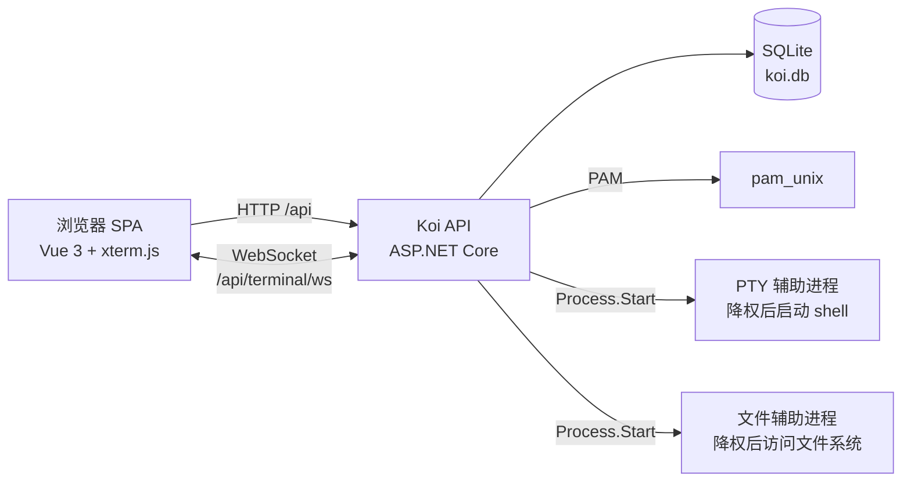

<p align="center">
  
</p>

<h1 align="center">Koi</h1>

<p align="center">
  <strong>Koi Linux Web UI</strong> —— 在浏览器中管理 Linux 主机。
</p>

<p align="center">
  <a href="LICENSE"></a>
  
  
  
</p>

<p align="center">
  <a href="README.md">English</a> · <strong>简体中文</strong>
</p>

## 概述

Koi 把一台 Linux 主机变成可以直接在浏览器里操作的工作站。用户使用**现有的系统账号**登录，密码由
PAM 校验，不需要额外维护一套账号体系；登录后进入统一工作区，包含在线终端、文件管理和多文件文本编辑。

项目面向家庭实验室、内网和自建服务器。它属于远程管理工具：一个已登录的浏览器会话，等同于以该用户身份
在主机上打开的 shell。

> **状态：** 尚未发布 1.0，仍在持续开发。界面目前仅有中文，也还没有自动化测试。在受信任网络之外使用前，
> 请先阅读[安全提示](#安全提示)。

## 功能特性

- **系统账号认证** —— 由 `pam_unix` 校验系统密码，不保存本地密码，也不重复创建账号。
- **多在线终端** —— 每个页签拥有独立的 PTY 和 shell 会话；在工作区内切换页签不会中断，关闭页签即销毁。
- **文件管理** —— 多页签浏览，每个页签的目录互相独立；目录级操作放在工具栏，行操作收进紧凑的
  `操作` 菜单：打开、编辑文本、下载、重命名、复制、剪切、删除。复制/剪切剪贴板在所有页签间共享，
  上传可指定是否覆盖。
- **在线文本编辑** —— 同时打开多个文件，支持 UTF-8（保留 BOM），保存时基于文件修改时间做乐观并发
  控制：文件已被外部修改时，可选择覆盖或重新加载。
- **单页工作区** —— 首页、终端、文件、编辑器页签在隐藏时保持各自状态，关闭页签时释放对应资源。
- **部署简单** —— 自包含单文件可执行程序、SQLite 存储、systemd 服务，并提供 deb/rpm 打包脚本。
- **健康检查与 ProblemDetails 错误** —— 便于监控和客户端集成。

## 架构



ASP.NET Core 进程负责 PAM 认证并托管构建好的前端。`pam_unix` 需要特权才能读取系统账号库，
因此服务本身必须具有特权 —— 所以主进程从不直接读写用户文件或创建 shell：终端和文件操作都由辅助进程
执行（同一个可执行文件带隐藏参数重新启动），辅助进程先降权到登录用户（`initgroups` → `setgid` →
`setuid`），再执行单次任务。主进程通过管道与其通信，从不在托管代码中 `fork()`。

会话以服务端记录的形式保存在 SQLite 中，浏览器只持有 HttpOnly 的 `koi_session` Cookie，数据库中仅
保存其 SHA-256 哈希。终端会话保存在内存中，连接断开、用户退出或服务停止时即被销毁。

## 环境要求

- **Linux** —— 终端与文件功能依赖 POSIX PTY，其他平台上这些接口返回 `503`。
- 可用的 PAM 服务，能够认证系统账号（默认 `login`）。
- **构建环境：** .NET SDK 10、Node.js 22+、npm。按下方命令发布出的程序是自包含的，目标主机无需安装
  .NET 运行时。
- **运行环境：** root 或等价的特权模型（`pam_unix` 需要读取账号库）；具体操作仍以登录用户的身份执行。

## 快速开始（开发）

```bash
git clone https://github.com/delly-net/Koi.git
cd Koi

# 终端 1：后端
cd api
dotnet run                 # http://localhost:5000

# 终端 2：前端
cd ui
npm install
npm run dev                # http://localhost:5173
```

使用 Vite 开发服务器时，请把 [ui/public/conf/setting.json](ui/public/conf/setting.json) 中的
`"baseUrl"` 设为 `""`，让接口和 WebSocket 保持同源并由 Vite 代理到后端（会话 Cookie 可直接生效）。
认证、终端和文件接口需要 Linux 环境，联调请使用 Linux 主机或虚拟机。

## 构建

```bash
# 后端：自包含单文件可执行程序
cd api
dotnet publish Koi.Api.csproj -c Release -r linux-x64 \
  --self-contained -p:PublishSingleFile=true -o ../publish

# 前端
cd ../ui
npm ci
npm run build              # 先用 vue-tsc 做类型检查，再构建到 ui/dist

# 前端必须位于可执行文件旁的 wwwroot
mkdir -p ../publish/wwwroot
cp -r dist/* ../publish/wwwroot/
```

生产构建会使用 [deploy/linux/conf/setting.json](deploy/linux/conf/setting.json)（同源
`baseUrl`）替换 `wwwroot/conf/setting.json`，两份配置需保持一致。

## 部署

仓库自带的脚本按维护者的目录布局编写（源码位于 `/project/delly-net/Koi`），可按实际路径调整。

```bash
# 注册服务（程序文件已复制到 /opt/delly-net/Koi）
sudo deploy/linux/install.sh            # 可选参数：服务名，默认 koi

# 或者构建 deb/rpm 安装包
./deploy/linux/package.sh all -p publish -o packages
sudo dpkg -i packages/koi-*.deb         # Debian / Ubuntu
sudo rpm -i  packages/koi-*.rpm          # RHEL / Fedora
```

`install.sh` 与安装包都会安装到 `/opt/delly-net/Koi`，创建并启用 `koi.service`，同时预置
`/etc/koi/appsettings.json`（已存在则不覆盖；安装包将其作为配置文件保留）。升级和卸载都不会删除
`koi.db`，会话数据与配置得以保留。

查看日志：`journalctl -u koi -f`。

## 配置

Linux 下后端会把 `/etc/koi/appsettings.json` 叠加到内置默认值之上。文件缺失时，首次启动会用内置
默认值创建；升级不会覆盖已有内容。未出现在该文件中的键会回退到内置默认值，因此发布目录中必须保留
`appsettings.json`。命令行参数和环境变量仍然优先。

| 配置键 | 默认值 | 说明 |
| --- | --- | --- |
| `Koi:Database:Path` | `koi.db` | SQLite 文件，相对内容根目录 |
| `Koi:StaticFiles:Enabled` | `true` | 从 `wwwroot` 托管前端 |
| `Koi:StaticFiles:RootPath` | `wwwroot` | 静态文件根目录 |
| `Koi:Auth:PamService` | `login` | 认证使用的 PAM 服务 |
| `Koi:Auth:SessionExpireHours` | `8` | 会话有效期（小时） |
| `Koi:Auth:LoginRateLimitPerMinute` | `10` | 每个 IP 每分钟的登录尝试次数 |
| `Koi:Auth:AllowedOrigins` | `[]` | 额外允许的来源（用于非安全方法） |
| `Koi:Terminal:Enabled` | `true` | 是否启用终端模块 |
| `Koi:Terminal:Shell` | `""` | 启动的 shell；空值表示账号的登录 shell |
| `Koi:Terminal:ShellArguments` | `["-l"]` | shell 参数 |
| `Koi:Terminal:MaxSessionsPerUser` | `4` | 每个用户的并发终端数 |
| `Koi:Terminal:MaxSessionsTotal` | `16` | 全部并发终端数 |
| `Koi:Files:Enabled` | `true` | 是否启用文件模块 |
| `Koi:Files:AllowedRoots` | `["/"]` | 用户可访问的目录 |
| `Koi:Files:MaxUploadBytes` | `104857600` | 上传上限（100 MiB） |
| `Koi:Files:MaxTextFileBytes` | `5242880` | 在线文本读写上限（5 MiB） |

前端启动时读取 `conf/setting.json`：

| 配置键 | 说明 |
| --- | --- |
| `baseUrl` | 后端根地址（**不含** `/api`）；`""` 表示同源 |
| `fileAssociations.text` | 可用文本编辑器打开的扩展名/文件名规则 |

`conf/setting.json` 以 `no-store` 下发，部署后可直接修改，无需重新构建。

## API

所有接口位于 `/api` 下，错误使用 ProblemDetails。除登录和健康检查外都需要会话 Cookie。

| 方法 | 路径 | 用途 |
| --- | --- | --- |
| `GET` | `/api/health` | 健康检查及平台能力标记 |
| `POST` | `/api/auth/login` | 使用系统账号登录 |
| `POST` | `/api/auth/logout` | 退出并关闭该用户的终端 |
| `GET` | `/api/auth/me` | 当前用户 |
| `GET` | `/api/terminal/ws` | WebSocket 终端（JSON 文本帧） |
| `GET` | `/api/files/roots` | 允许的根目录 |
| `GET` | `/api/files/list?path=` | 目录列表 |
| `POST` | `/api/files/mkdir`、`/touch`、`/rename`、`/delete`、`/copy`、`/move` | 文件操作 |
| `POST` | `/api/files/upload?path=&overwrite=` | 表单上传 |
| `GET` | `/api/files/download?path=` | 下载文件 |
| `GET` / `POST` | `/api/files/text` | 读取 / 写入 UTF-8 文本 |

终端协议为 camelCase JSON：客户端发送 `input`、`resize`、`ping`，服务端发送 `ready`、`output`、
`exit`、`error`、`pong`。完整契约及相关架构约束见 [CLAUDE.md](CLAUDE.md)。

## 安全提示

Koi 是管理工具，并非面向公网加固过的堡垒机。部署前请确认：

- **在它前面终止 TLS。** 程序不提供 HTTPS，默认监听 `http://0.0.0.0:5000`。请使用 Nginx、Caddy
  等反向代理，不要把端口直接暴露到公网；程序会使用 `X-Forwarded-For` / `X-Forwarded-Proto`。
- **服务本身具有特权。** `pam_unix` 需要访问账号库，自带的 systemd 单元以 root 运行。所有 shell 和
  文件操作都交给降权后的辅助进程执行，但仍应把 Koi 部署在受信任的主机上，并限制访问来源。
- **仅使用 PAM 认证。** 没有本地密码库，没有多因素认证，除系统自身日志外没有额外审计。
- **会话：** HttpOnly `SameSite=Lax` Cookie，服务端只保存 SHA-256 哈希，8 小时过期；退出会关闭该用户
  的终端，连接断开即释放终端状态。
- **请求防护：** 非安全 HTTP 方法做同源校验，WebSocket 握手单独校验来源，登录按 IP 限流。
- **文件可见范围默认为 `/`。** 请把 `Koi:Files:AllowedRoots` 收窄到实际需要的目录；真正的边界是登录
  用户的操作系统权限。
- 部署后检查 `/etc/koi/appsettings.json`：配置只在启动时读取一次，修改后需重启服务。

## 目录结构

```
Koi/
├── api/                 ASP.NET Core Minimal API（.NET 10）
│   ├── Auth/            PAM 认证、会话、同源校验
│   ├── Configuration/   /etc/koi/appsettings.json 外部配置
│   ├── Data/            EF Core + SQLite 会话存储
│   ├── Files/           文件接口、路径策略、降权辅助进程
│   ├── Hosting/         静态文件与 SPA 回退
│   ├── Terminal/        PTY、辅助进程、会话注册表、WebSocket
│   └── Program.cs
├── ui/                  Vue 3 + TypeScript + Element Plus 单页应用（Vite）
│   ├── src/api/         HTTP 封装与协议类型
│   ├── src/stores/      Pinia 状态（认证、工作区、编辑器、剪贴板）
│   ├── src/views/       登录页与工作区各面板
│   └── public/conf/     运行时配置
├── deploy/linux/        构建、安装与打包脚本
└── icon/                应用图标
```

## 参与贡献

欢迎提交 Issue 和 Pull Request；较大的改动请先开 Issue 讨论。

- 提交前在 `api/` 执行 `dotnet build`，在 `ui/` 执行 `npm run build`（同时包含 `vue-tsc` 类型检查）。
- 终端和文件相关的改动必须在 Linux 主机上验证，并在 PR 中说明手工验证步骤（目前还没有自动化测试）。
- 新增接口或修改协议时，请同步更新 [CLAUDE.md](CLAUDE.md)，其中记录了架构约束和当前 API 契约。
- 界面文案为中文，新增文案请与现有措辞保持一致。

## 许可证

[MIT](LICENSE) © 2026 delly.net
