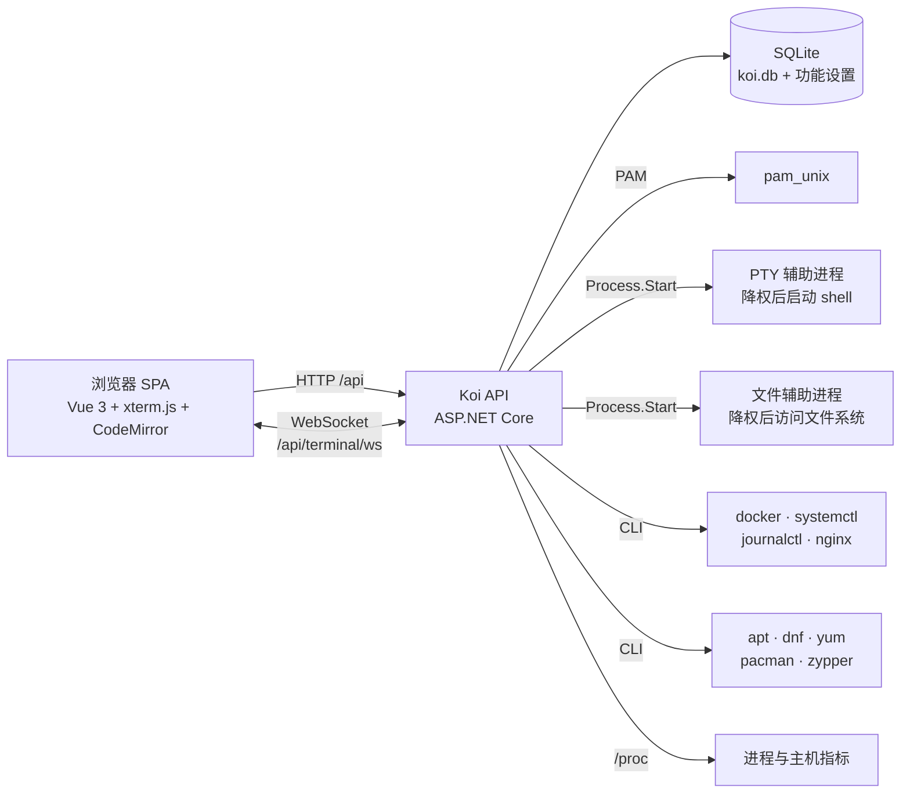

<p align="center">
  
</p>

<h1 align="center">Koi</h1>

<p align="center">
  <strong>Koi Linux Web UI</strong> —— 在浏览器中管理 Linux 主机。
</p>

<p align="center">
  <a href="LICENSE"></a>
  
  
  
</p>

<p align="center">
  <a href="README.md">English</a> · <strong>简体中文</strong>
</p>

## 概述

Koi 把一台 Linux 主机变成可以直接在浏览器里操作的工作站。用户使用**现有的系统账号**登录，密码由
PAM 校验，不需要额外维护一套账号体系；登录后进入统一工作区，包含十大模块：

- **首页**：CPU、内存、磁盘、网络的实时状态面板；
- **在线终端**、**文件管理**、**多文件文本编辑**与**图片浏览**；
- **服务管理**、**进程管理**、**应用管理**、**容器管理**与 **Nginx 配置管理**。

项目面向家庭实验室、内网和自建服务器。它属于远程管理工具：一个已登录的浏览器会话，等同于以该用户身份
在主机上打开的 shell。

> **状态：** 尚未发布 1.0，仍在持续开发。界面目前仅有中文，也还没有自动化测试。在受信任网络之外使用前，
> 请先阅读[安全提示](#安全提示)。

## 功能特性

- **系统账号认证** —— 由 `pam_unix` 校验系统密码，不保存本地密码，也不重复创建账号。
- **单页工作区** —— 首页、终端、文件、编辑、图片、服务、进程、应用、容器、Nginx 页签在隐藏时保持
  各自状态，关闭页签时释放对应资源。
- **多在线终端** —— 每个页签拥有独立的 PTY 和 shell 会话；在工作区内切换页签不会中断，关闭页签即销毁。
  在文件管理中可直接把目录打开到新的终端页签，shell 从该目录启动。
- **文件管理** —— 文件管理器本身支持多页签，每个页签浏览独立目录；可调节宽度的**快速访问**侧栏（按登录
  账号存储于 SQLite）位于惰性加载的**目录树**之上，路径栏支持绝对路径、`~` 路径与相对路径**跳转**；
  支持上传、下载、重命名、复制/剪切与跨页签共享剪贴板的粘贴。
- **在线文本编辑** —— 基于 CodeMirror 同时打开多个文件，支持 UTF-8（保留 BOM），按文件扩展名选择语法
  着色方案，保存时基于文件修改时间做乐观并发控制：文件已被外部修改时，可选择覆盖或重新加载。
- **图片浏览** —— 按目录递归列出所有受支持的图片（含子目录），以 128×128 后端缩略图网格排列；
  点击进入全屏查看器，支持放大缩小、拖动平移、旋转、水平/垂直翻转，并通过屏幕左右两侧的半透明箭头
  切换上一张/下一张。缩略图落盘缓存，图片修改后自动重新生成。
- **服务管理** —— 查看、检查并控制系统服务（`start` / `stop` / `restart` / `reload`），管理开机自启，
  查看 `journalctl` 日志。
- **进程管理** —— 基于 `/proc` 查看进程的 CPU/内存占用与命令行，查看进程详情（可执行文件、工作目录、
  I/O、打开的 fd 数），并用 `SIGTERM` 或 `SIGKILL` 结束进程。
- **应用管理** —— 通过 apt、dnf、yum、pacman 或 zypper 安装、卸载与升级软件包；SQLite 缓存的已安装
  应用列表支持分页与状态筛选；后台任务带实时日志；支持添加、启用、禁用与删除软件源。
- **容器管理** —— 通过 docker CLI 查看与检查容器、镜像，启停/重启/暂停容器，查看日志与资源占用，
  拉取、打标签、清理与删除镜像。
- **Nginx 管理** —— 列出并编辑 `conf.d/*.conf`，执行 `nginx -t` 做语法检测、`nginx -s reload` 做热加载。
- **模块设置界面化** —— 各模块的运行期配置存储于 SQLite，由 root 在对应页面右上角的设置抽屉中维护，
  保存后立即生效。
- **健康检查与 ProblemDetails 错误** —— 便于监控和客户端集成。

## 模块与授权

| 工作区页签 | 主要能力 | 可用范围 |
| --- | --- | --- |
| 首页 | 主机状态面板与模块入口 | 所有登录账号 |
| 在线终端 | 以登录账号身份运行的 PTY shell | 所有登录账号 |
| 文件管理 | 以登录账号身份浏览目录与操作文件 | 所有登录账号（受操作系统权限约束） |
| 文本编辑 | UTF-8 文本编辑，包括 Nginx 配置文件 | 所有登录账号；Nginx 配置页签遵循 Nginx 授权 |
| 图片浏览 | 递归列出图片、128×128 缓存缩略图与全屏查看器 | 所有登录账号（受操作系统权限约束） |
| 服务管理 | `systemctl` / `journalctl` | root 或配置允许组的成员（默认 `sudo`、`wheel`） |
| 进程管理 | `/proc` 检查与信号发送 | root 或 `sudo` / `wheel` |
| 应用管理 | 包管理器命令行 | root 或 `sudo` / `wheel`；变更操作还要求 Koi 服务本身以 root 运行 |
| 容器管理 | docker 命令行 | root 或 `docker` 组成员 |
| Nginx 管理 | conf.d 文件与 nginx 命令 | root 或 `sudo` / `wheel` |
| 设置抽屉 | 各模块运行期配置 | 仅 root |

组成员身份通过 `id -nG` 解析，因此 NSS/LDAP 组同样生效。在模块已启用且可用的前提下，uid 0 始终放行；
配置的组列表只约束普通账号。

## 架构



ASP.NET Core 进程负责 PAM 认证并托管构建好的前端。`pam_unix` 需要特权才能读取系统账号库，
因此服务本身必须具有特权 —— 所以主进程从不直接读写用户文件或创建 shell：终端和文件操作都由辅助进程
执行（同一个可执行文件带隐藏参数重新启动），辅助进程先降权到登录用户（`initgroups` → `setgid` →
`setuid`），再执行单次任务。主进程通过管道与其通信，从不在托管代码中 `fork()`。

特权模块由主进程通过 `Process.Start` + 参数列表调用各自的命令行 —— 从不经由 shell，且只执行固定的
子命令白名单。因此 docker、systemctl、nginx 与包管理器以服务账号的特权运行，这也是它们仅对配置的组
开放的原因。进程与主机指标直接从 `/proc` 读取，不执行外部命令。

会话以服务端记录的形式保存在 SQLite 中，浏览器只持有 HttpOnly 的 `koi_session` Cookie，数据库中仅
保存其 SHA-256 哈希。终端会话保存在内存中，连接断开、用户退出或服务停止时即被销毁。

## 环境要求

- **Linux** —— 终端与文件功能依赖 POSIX PTY，其他平台上这些接口返回 `503`；特权模块还需要各自的工具
  （`docker`、`systemctl` / `journalctl`、`nginx`、受支持的包管理器）。
- 可用的 PAM 服务，能够认证系统账号（默认 `login`）。
- **构建环境：** .NET SDK 10、Node.js 22+、npm。按下方命令发布出的程序是自包含的，目标主机无需安装
  .NET 运行时。
- **运行环境：** root 或等价的特权模型（`pam_unix` 需要读取账号库）；具体操作仍以登录用户的身份执行。
- **可选组：** 把管理员账号加入服务、进程、应用与 Nginx 使用的组（默认 `sudo` / `wheel`），加入
  `docker` 组以使用容器管理。

## 快速开始（开发）

```bash
git clone https://github.com/delly-net/Koi.git
cd Koi

# 终端 1：后端
cd api
dotnet run                 # http://localhost:5000

# 终端 2：前端
cd ui
npm install
npm run dev                # http://localhost:5173
```

使用 Vite 开发服务器时，请把 [ui/public/conf/setting.json](ui/public/conf/setting.json) 中的
`"baseUrl"` 设为 `""`，让接口和 WebSocket 保持同源并由 Vite 代理到后端（会话 Cookie 可直接生效）。
认证、终端和文件接口需要 Linux 环境，联调请使用 Linux 主机或虚拟机。

## 构建

```bash
# 后端：自包含单文件可执行程序
cd api
dotnet publish Koi.Api.csproj -c Release -r linux-x64 \
  --self-contained -p:PublishSingleFile=true -o ../publish

# 前端
cd ../ui
npm ci
npm run build              # 先用 vue-tsc 做类型检查，再构建到 ui/dist

# 前端必须位于可执行文件旁的 wwwroot
mkdir -p ../publish/wwwroot
cp -r dist/* ../publish/wwwroot/
```

生产构建会使用 [deploy/linux/conf/setting.json](deploy/linux/conf/setting.json)（同源
`baseUrl`）替换 `wwwroot/conf/setting.json`，两份配置需保持一致。

## 部署

仓库在 [deploy/linux/](deploy/linux/) 下提供脚本（[deploy/debian/](deploy/debian/) 下另有一套
同类脚本）。脚本按维护者的目录布局编写（源码位于 `/project/delly-net/Koi`），可按实际路径调整。

```bash
# 注册服务（程序文件已复制到 /opt/delly-net/Koi）
sudo deploy/linux/install.sh            # 可选参数：服务名，默认 koi

# 或者构建 deb/rpm 安装包
./deploy/linux/package.sh all -p publish -o packages
sudo dpkg -i packages/koi-*.deb         # Debian / Ubuntu
sudo rpm -i  packages/koi-*.rpm          # RHEL / Fedora
```

`install.sh` 与安装包都会安装到 `/opt/delly-net/Koi`，创建并启用 `koi.service`，同时预置
`/etc/koi/appsettings.json`（已存在则不覆盖；安装包将其作为配置文件保留）。升级和卸载都不会删除
`koi.db`，会话数据与配置得以保留。

查看日志：`journalctl -u koi -f`。

## 配置

### 后端基础配置

Linux 下后端会把 `/etc/koi/appsettings.json` 叠加到内置默认值之上。文件缺失时，首次启动会用内置
默认值创建；升级不会覆盖已有内容。未出现在该文件中的键会回退到内置默认值，因此发布目录中必须保留
`appsettings.json`。命令行参数和环境变量仍然优先。配置只在启动时读取一次，修改后需重启服务。

| 配置键 | 默认值 | 说明 |
| --- | --- | --- |
| `Koi:Database:Path` | `koi.db` | SQLite 文件，相对内容根目录 |
| `Koi:StaticFiles:Enabled` | `true` | 从 `wwwroot` 托管前端 |
| `Koi:StaticFiles:RootPath` | `wwwroot` | 静态文件根目录 |
| `Koi:Auth:PamService` | `login` | 认证使用的 PAM 服务 |
| `Koi:Auth:SessionExpireHours` | `8` | 会话有效期（小时） |
| `Koi:Auth:CookieName` | `koi_session` | 会话 Cookie 名称 |
| `Koi:Auth:LoginRateLimitPerMinute` | `10` | 每个 IP 每分钟的登录尝试次数 |
| `Koi:Auth:AllowedOrigins` | `[]` | 额外允许的来源（用于非安全方法） |
| `Koi:SystemMonitor:Enabled` | `true` | 是否启用首页状态采集 |
| `Urls` | `http://0.0.0.0:5000` | Kestrel 监听地址 |

### 模块设置（SQLite 与设置抽屉）

终端、文件、编辑、服务、进程、应用、容器与 Nginx 的设置**不**从 `appsettings.json` 读取。它们保存在
SQLite 中，由 root 通过各模块页面右上角的齿轮按钮打开的设置抽屉维护，保存后立即生效、无需重启服务。
旧的 `Koi:Terminal`、`Koi:Files`、`Koi:Docker`、`Koi:Services`、`Koi:Packages`、`Koi:Nginx` 与
`Koi:Processes` 配置节不再读取。

| 模块 | 抽屉中可编辑的设置 | 存储 |
| --- | --- | --- |
| 在线终端 | 启用开关、shell 及参数、会话数上限、单条输入上限、默认行列、关闭超时 | `FeatureConfigs`（`Feature = terminal`） |
| 文件管理 | 启用开关、允许根目录、上传/列表/文本上限、辅助进程与传输超时 | `FeatureConfigs`（`Feature = files`） |
| 文本编辑 | 视为文本的扩展名及每个扩展名的着色方案 | `EditorFileTypes` 表 |
| 服务管理 | 启用开关、`systemctl` / `journalctl` 路径、允许组、超时、输出/日志上限、日志行数 | `FeatureConfigs`（`Feature = services`） |
| 进程管理 | 启用开关、允许组、进程与命令行上限、采样窗口、结束等待、刷新间隔 | `FeatureConfigs`（`Feature = process`） |
| 应用管理 | 启用开关、包管理器、允许组、超时、输出/日志上限、任务保留与数量上限 | `FeatureConfigs`（`Feature = packages`） |
| 容器管理 | 启用开关、docker 路径、允许组、超时、输出/日志上限、日志行数 | `FeatureConfigs`（`Feature = docker`） |
| Nginx 管理 | 启用开关、可执行文件与配置路径、conf.d 目录、允许组、超时、大小上限 | `FeatureConfigs`（`Feature = nginx`） |

快速访问目录（`FileQuickAccess`）与已安装应用缓存（`PackageCacheItems`）同样存储于 SQLite。设置端点
仅限 root，并有意跳过启用/平台检查，以便配置被写坏时仍可修复。

### 前端配置

前端启动时读取 `conf/setting.json`：

| 配置键 | 说明 |
| --- | --- |
| `baseUrl` | 后端根地址（**不含** `/api`）；`""` 表示同源 |

`conf/setting.json` 以 `no-store` 下发，部署后可直接修改，无需重新构建。原有的
`fileAssociations.text` 字段已废弃并被忽略：文本关联与着色方案现由后端提供。

## API

所有接口位于 `/api` 下，错误使用 ProblemDetails。除登录和健康检查外都需要会话 Cookie。完整契约及
相关架构约束见 [CLAUDE.md](CLAUDE.md)。

### 健康检查与认证

| 方法 | 路径 | 用途 |
| --- | --- | --- |
| `GET` | `/api/health` | 健康检查及平台能力标记 |
| `POST` | `/api/auth/login` | 使用系统账号登录 |
| `POST` | `/api/auth/logout` | 退出并关闭该用户的终端 |
| `GET` | `/api/auth/me` | 当前用户 |

### 终端

| 方法 | 路径 | 用途 |
| --- | --- | --- |
| `GET` | `/api/terminal/ws[?cwd=]` | WebSocket 终端（JSON 文本帧） |
| `GET` / `PUT` | `/api/terminal/settings` | 终端设置（root） |

### 文件管理

| 方法 | 路径 | 用途 |
| --- | --- | --- |
| `GET` | `/api/files/roots` | 允许的根目录 |
| `GET` / `PUT` | `/api/files/settings` | 文件设置（root） |
| `GET` | `/api/files/list?path=` | 目录列表 |
| `POST` | `/api/files/mkdir`、`/touch`、`/rename`、`/delete`、`/copy`、`/move` | 文件操作 |
| `POST` | `/api/files/upload?path=&overwrite=` | 表单上传 |
| `GET` | `/api/files/download?path=` | 下载文件 |
| `GET` / `POST` | `/api/files/text` | 读取 / 写入 UTF-8 文本 |
| `GET` / `POST` | `/api/files/quick-access` | 按账号读取 / 添加快速访问 |
| `DELETE` | `/api/files/quick-access/{id}` | 移除快速访问条目 |

### 文本编辑

| 方法 | 路径 | 用途 |
| --- | --- | --- |
| `GET` | `/api/editor/associations` | 文本文件规则（所有登录账号可读） |
| `GET` / `PUT` | `/api/editor/settings` | 扩展名与着色方案（root） |

### 服务

| 方法 | 路径 | 用途 |
| --- | --- | --- |
| `GET` / `PUT` | `/api/services/settings` | 服务设置（root） |
| `GET` | `/api/services` | 服务列表及运行/自启状态 |
| `GET` | `/api/services/{name}` | 服务详情 |
| `POST` | `/api/services/{name}/{start\|stop\|restart\|reload\|enable\|disable}` | 生命周期操作 |
| `GET` | `/api/services/{name}/logs?tail=` | `journalctl` 快照 |

### 进程

| 方法 | 路径 | 用途 |
| --- | --- | --- |
| `GET` / `PUT` | `/api/processes/settings` | 进程设置（root） |
| `GET` | `/api/processes` | 进程快照及 CPU、内存占用 |
| `GET` | `/api/processes/{pid}` | 进程详情 |
| `POST` | `/api/processes/{pid}/terminate?force=` | 发送 SIGTERM；`force=true` 时发送 SIGKILL |

### 应用

| 方法 | 路径 | 用途 |
| --- | --- | --- |
| `GET` | `/api/packages/status` | 检测到的包管理器、版本与修改能力 |
| `GET` | `/api/packages/installed`、`/search?q=`、`/updates` | 实时软件包查询 |
| `GET` | `/api/packages/cache?page=&pageSize=&status=&query=` | 缓存的已安装应用列表 |
| `PUT` | `/api/packages/cache/{id}` | 编辑缓存简介 |
| `POST` | `/api/packages/cache/refresh` | 重建缓存 |
| `POST` | `/api/packages/jobs` | 启动安装/卸载/升级/刷新任务 |
| `GET` | `/api/packages/jobs/{id}?offset=` | 增量任务日志 |
| `POST` | `/api/packages/jobs/{id}/cancel` | 取消运行中的任务 |
| `GET` / `PUT` | `/api/packages/settings` | 应用设置（root） |
| `GET` / `POST` | `/api/packages/sources` | 列出 / 添加软件源 |
| `POST` | `/api/packages/sources/{id}/enable`、`/disable` | 启用 / 禁用软件源 |
| `DELETE` | `/api/packages/sources/{id}` | 删除软件源 |

### 容器

| 方法 | 路径 | 用途 |
| --- | --- | --- |
| `GET` / `PUT` | `/api/docker/settings` | 容器设置（root） |
| `GET` | `/api/docker/status` | docker 版本与守护进程状态 |
| `GET` | `/api/docker/containers`、`/containers/{id}` | 列出 / 检查容器 |
| `POST` | `/api/docker/containers/{id}/{start\|stop\|restart\|pause\|unpause}` | 容器操作 |
| `DELETE` | `/api/docker/containers/{id}?force=&volumes=` | 删除容器 |
| `GET` | `/api/docker/containers/{id}/logs?tail=` | 容器日志 |
| `GET` | `/api/docker/stats` | 一次性资源占用 |
| `GET` | `/api/docker/images` | 镜像列表及容器引用 |
| `POST` | `/api/docker/images/pull`、`/tag`、`/prune` | 镜像操作 |
| `DELETE` | `/api/docker/images/{id}?force=` | 删除镜像 |

### Nginx

| 方法 | 路径 | 用途 |
| --- | --- | --- |
| `GET` / `PUT` | `/api/nginx/settings` | Nginx 设置（root） |
| `GET` | `/api/nginx/status` | 版本与 conf.d 目录 |
| `GET` | `/api/nginx/configs`、`/configs/{name}` | 列出 / 读取配置文件 |
| `PUT` | `/api/nginx/configs/{name}` | 保存配置文件 |
| `POST` | `/api/nginx/test`、`/reload` | `nginx -t` / `nginx -s reload` |

### 主机状态

| 方法 | 路径 | 用途 |
| --- | --- | --- |
| `GET` | `/api/system/status` | CPU、内存、Swap、负载、磁盘与网络速率 |

终端协议为 camelCase JSON：客户端发送 `input`、`resize`、`ping`，服务端发送 `ready`、`output`、
`exit`、`error`、`pong`。`/api/health` 返回 `pamAvailable`、`terminalAvailable`、`fileAvailable`、
`dockerAvailable`、`systemMonitorAvailable`、`serviceAvailable`、`processAvailable`、
`nginxAvailable` 与 `packageAvailable`。

## 安全提示

Koi 是管理工具，并非面向公网加固过的堡垒机。部署前请确认：

- **在它前面终止 TLS。** 程序不提供 HTTPS，默认监听 `http://0.0.0.0:5000`。请使用 Nginx、Caddy
  等反向代理，不要把端口直接暴露到公网；程序会使用 `X-Forwarded-For` / `X-Forwarded-Proto`。
- **服务本身具有特权。** `pam_unix` 需要访问账号库，自带的 systemd 单元以 root 运行。所有 shell 和
  文件操作都交给降权后的辅助进程执行，但仍应把 Koi 部署在受信任的主机上，并限制访问来源。
- **特权模块等同于宿主 root。** docker socket、`systemctl`、nginx 配置与包管理器都能改动整个系统。
  Koi 用配置的组限制访问（且只有 root 能编辑它们的设置），但任何被允许的账号实际上都是管理员，
  请谨慎授权。
- **仅使用 PAM 认证。** 没有本地密码库，没有多因素认证，除系统自身日志外没有额外审计。
- **会话：** HttpOnly `SameSite=Lax` Cookie，服务端只保存 SHA-256 哈希，8 小时过期；退出会关闭该用户
  的终端，连接断开即释放终端状态。
- **请求防护：** 非安全 HTTP 方法做同源校验，WebSocket 握手单独校验来源，登录按 IP 限流。
- **设置仅限 root。** 模块设置端点要求会话与 uid 0；非 root 用户不会看到设置抽屉。
- **文件可见范围默认为 `/`。** 请通过文件管理设置抽屉把允许的根目录收窄到实际需要的目录；真正的
  边界是登录用户的操作系统权限。快速访问条目只是导航快捷方式，不授予任何访问权限。
- 部署后检查 `/etc/koi/appsettings.json`：基础配置只在启动时读取一次，修改后需重启服务；SQLite 中的
  模块设置保存后立即生效。

## 目录结构

```
Koi/
├── api/                 ASP.NET Core Minimal API（.NET 10）
│   ├── Auth/            PAM 认证、会话、同源校验
│   ├── Configuration/   /etc/koi 外部配置与设置存储
│   ├── Data/            EF Core + SQLite 实体与建表辅助
│   ├── Docker/          docker CLI、授权与端点
│   ├── Editor/          文本文件规则、着色方案与端点
│   ├── Files/           文件接口、路径策略、降权辅助进程
│   ├── Hosting/         静态文件与 SPA 回退
│   ├── Monitor/         基于 /proc 与 statvfs 的主机指标
│   ├── Nginx/           conf.d 文件、nginx 命令与端点
│   ├── Packages/        包管理器后端、任务、软件源与端点
│   ├── Processes/       /proc 进程采样与信号发送
│   ├── Services/        systemctl / journalctl 与端点
│   ├── Terminal/        PTY、辅助进程、会话注册表、WebSocket
│   └── Program.cs
├── ui/                  Vue 3 + TypeScript + Element Plus 单页应用（Vite）
│   ├── src/api/         HTTP 封装与各模块协议类型
│   ├── src/components/  终端、编辑器、文件与系统组件
│   ├── src/config/      运行时配置与着色方案
│   ├── src/stores/      Pinia 状态（认证、工作区、编辑器、剪贴板等）
│   ├── src/utils/       布局与记住登录辅助
│   ├── src/views/       登录页与工作区各面板
│   └── public/conf/     运行时配置
├── deploy/
│   ├── linux/           构建、安装与打包脚本
│   └── debian/          另一套构建与打包脚本
└── icon/                应用图标
```

## 参与贡献

欢迎提交 Issue 和 Pull Request；较大的改动请先开 Issue 讨论。

- 提交前在 `api/` 执行 `dotnet build`，在 `ui/` 执行 `npm run build`（同时包含 `vue-tsc` 类型检查）。
- 终端和文件相关的改动必须在 Linux 主机上验证，并在 PR 中说明手工验证步骤（目前还没有自动化测试）。
- 新增接口、协议变更或架构决策时，请同步更新 [CLAUDE.md](CLAUDE.md)，其中记录了架构约束和当前
  API 契约。
- 界面文案为中文，新增文案请与现有措辞保持一致。

## 许可证

[MIT](LICENSE) © 2026 delly.net
